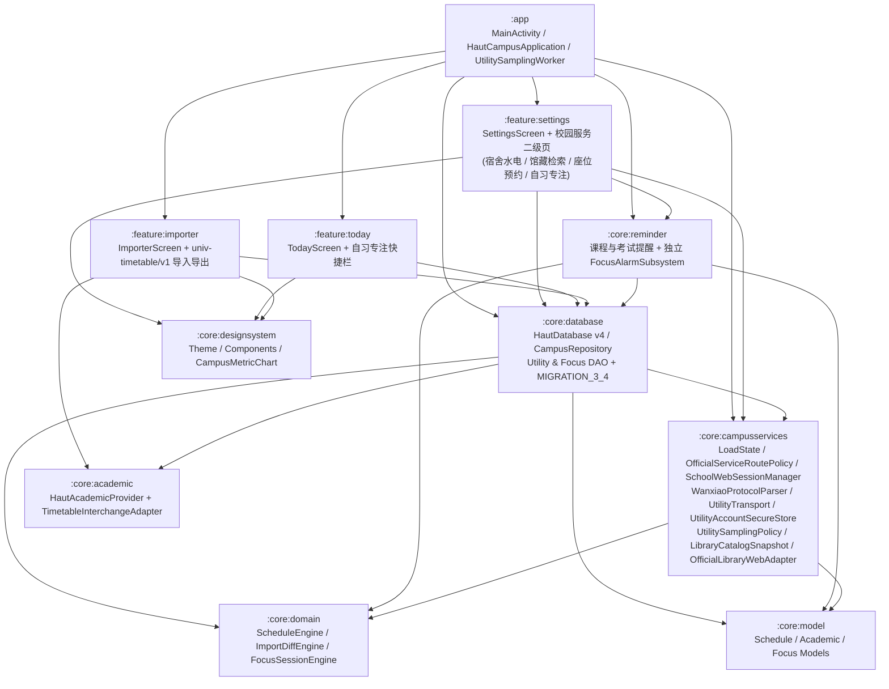

# 校园服务模块架构说明 (Campus Services Architecture)

本文档定义「日在校园 (Day in School)」在保持既有五栏悬浮导航（今天 / 课表 / 学业 / 校园 / 我的）、`ScheduleEngine`、MapLibre 校园 GIS、4 款桌面小组件与 `:core:reminder` 提醒引擎不变的前提下，接入宿舍水电、图书馆馆藏查询、图书馆座位预约、自习专注计时及 `univ-timetable/v1` 课表互通的分层架构。

---

## 一、模块边界与依赖拓扑

---

## 二、核心基础设施契约 (`:core:campusservices`)

### 1. 统一状态与错误模型 (`LoadState<T>` & `ServiceError`)
- `LoadState.Idle`：初始未触发状态。
- `LoadState.Loading`：请求或页面解析执行中。
- `LoadState.Content<T>(data, updatedAtEpochMs, isStale)`：有效内容态，支持标记离线缓存或陈旧态。
- `LoadState.Empty(reason)`：明确无数据（如未绑定宿舍房间、未检索到匹配书目）。
- `LoadState.Failed(error: ServiceError, cachedSnapshot: T?)`：失败态，保留上一次有效快照供离线降级浏览。

`ServiceError` 划分为 8 类标准错误码：
- `NETWORK_UNAVAILABLE`：网络不可达或连接超时。
- `TLS_OR_ROUTE_BLOCKED`：HTTPS 证书校验失败或非白名单域名拦截。
- `AUTH_REQUIRED`：需在学校官方页面完成统一身份认证。
- `NO_BOUND_ROOM`：账号未在完美校园绑定宿舍房间。
- `UPSTREAM_CHANGED`：上游接口或网页 DOM 结构变化，已降级或停止解析。
- `RATE_LIMITED`：请求过于频繁或单次批量查询超出预算。
- `STORAGE_KEY_INVALIDATED`：Android Keystore 密钥失效，已自动重置并需重新输入账号。
- `TRANSPORT_UNVERIFIED`：智能水电在线传输层处于待实机核验阶段，需用户知情确认或使用手工记录。

### 2. 官方域名白名单与路由策略 (`OfficialServiceRoutePolicy`)
- 仅使用 `java.net.URI` 解析 URL，拒绝依赖 `String.contains` 或宽松前缀匹配。
- 严格校验 `scheme == "https"`（仅 `about:blank` / `about:srcdoc` 在子框架受控放行）、`userInfo == null`、`port in setOf(-1, 443)`。
- 域名精确匹配或受控子域匹配：
  - 学校官方站点：`haut.edu.cn` 及其子域名（`jwglxt.haut.edu.cn`、`libspace.haut.edu.cn`、`wslib.haut.edu.cn`、`mapp.haut.edu.cn`）。
  - 智能水电网关：`xqh5.17wanxiao.com`。
  - 馆藏封面静态资源：`libspace.haut.edu.cn`、`img.hwlsp.cn`、`*.ddimg.cn`（剥离全部 Query、Fragment 与 UserInfo，且不附带 Cookie）。

### 3. 学校网页共享会话 (`SchoolWebSessionManager`)
- 统一管理正方教务网页导入、图书馆馆藏检索与图书馆座位预约的 `WebView` 安全基线：
  - `allowFileAccess = false`、`allowContentAccess = false`
  - `mixedContentMode = WebSettings.MIXED_CONTENT_NEVER_ALLOW`
  - 严禁调用 `addJavascriptInterface`
  - `onReceivedSslError` 固定调用 `handler.cancel()`
- `persistCookiesAsync()` 通过单线程后台调度器串行执行 `CookieManager.getInstance().flush()`，避免阻塞主线程。
- `clearAllSchoolWebSessions()` 同时清除 `CookieManager` 全部 Cookie 与 `WebStorage.getInstance().deleteAllData()`，并挂接至 `CampusRepository.wipeAllPersonalData()` 预清理钩子。

---

## 三、四大业务子系统与课表互通架构

### 1. 宿舍水电（在线查询 + 周期采样 + 手工台账）
- **协议解析 (`WanxiaoProtocolParser`)**：解析完美校园 `getbindroom`（`existflag` 0/1/2，上限 20 间）与 `h5_getstuindexpage`（`modlist`，上限 50 台设备，兼容 `bussnesstype`/`businesstype` 0=电、1=水），原样保留 `odd`/`todayuse`/`sumbuy`/`status` 文本。
- **安全传输 (`WanxiaoFormPostTransport`)**：强制使用 `POST` + `application/x-www-form-urlencoded; charset=UTF-8` 请求体传递 `customercode=43`、`method` 与 `param`，**严禁将 `account` 或 `roomverify` 拼入 URL Query**。
- **凭据安全 (`UtilityAccountSecureStore`)**：采用 Android Keystore `AES/GCM/NoPadding` 加密存储校园卡账号，支持密钥失效自愈、脱敏展示（如 `2023****1012`）与单账号切换自动清空旧房间缓存。
- **每日采样 (`UtilitySamplingPolicy` & `UtilitySamplingWorker`)**：按 `Asia/Shanghai` 自然日归档，白昼 60 分钟、23:00 后 15 分钟采样；跨零点请求（`!sameDay(startedAt, finishedAt)`）直接丢弃不跨日记账；折线图 `CampusMetricChart` 在缺测日或余额回升（未知购电）处自动分段绘制。

### 2. 图书馆馆藏检索 (`OfficialLibraryWebAdapter` & `LibraryCatalogSnapshot`)
- 通过受控离屏 `WebView` 加载 `https://libspace.haut.edu.cn/mspace/index` 并在 `onPageFinished`、`doUpdateVisitedHistory` 与用户动作后采用有界退避（`80ms..3000ms`）注入只读 `catalog-snapshot.js`，替代上游 800ms 无限轮询。
- 快照载荷上限 `1,000,000` 字符、单页最多 `200` 本书、单书最多 `150` 条馆藏；为每本书绑定 `pageGeneration`，翻页后阻断旧快照误点击。
- 原生界面出现任何解析失败或上游改版时，提供一键切换「打开官方检索页」内嵌浏览模式。

### 3. 图书馆座位预约 (`LibrarySeatBookingScreen`)
- 直连学校官方选座 H5（`https://wslib.haut.edu.cn/h5/index.html#/seatPage/SelectRoom/SelectRoom`）。
- 当跳转至 `mapp.haut.edu.cn` 完成统一身份认证并返回 `wslib.haut.edu.cn/h5/index.html` 时，由一次性状态机消费 `pendingReturnToSeatSelection` 标志并设置目标路由 hash，不抓取认证令牌、不实现自动抢座。

### 4. 自习专注计时 (`FocusSessionEngine` & `FocusAlarmSubsystem`)
- 独立 `focus_sessions` 表、`FocusAlarmReceiver`、`FocusRestoreReceiver`、专属通知渠道 `focus_timer_channel_v1` 与 `haut://focus/alarm/{sessionId}?gen={generation}`，与 `:core:reminder` 课程/考试提醒物理隔离。
- 支持 15 / 25 / 45 分钟预设及 1–180 分钟自定义、15 分钟重启迟到静默窗口、课前 20 分钟非强制提示以及 10 秒后台送达诊断。

### 5. 课表文件互通 (`TimetableInterchangeAdapter`)
- 支持导入导出 `univ-timetable/v1` 标准 JSON 与 Markdown 文件，自动将不连续节次拆分为连续 `ImportCourseCandidate` 并汇入 `ImportDiffEngine`，100% 保护用户本地手动修改的课程（`userModified = true`），导出文件严格剔除学号、姓名等个人敏感字段。
